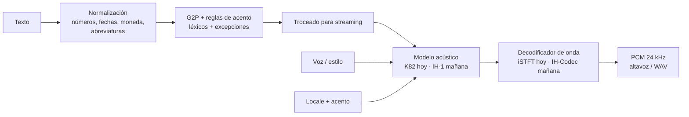
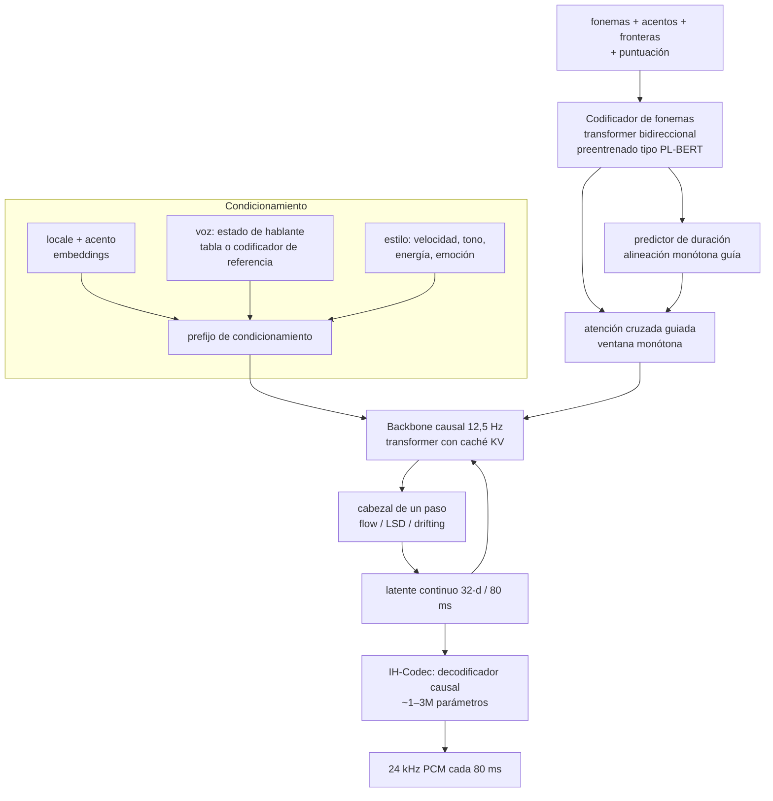

# Arquitectura de Inhouse TTS

Este documento recoge el **diseño del sistema** y el **plan de la arquitectura del modelo propio (IH-1)**. Se apoya en la investigación de [RESEARCH.md](RESEARCH.md).

## 1. Requisitos

| Requisito | Qué significa en la práctica |
|---|---|
| Voz hiperrealista y natural | calidad de los mejores modelos abiertos pequeños: Elo AA ≥ Kokoro, UTMOS ≥ 4,3, WER < 2 % |
| Internacional y multilingüe | un solo modelo con varios idiomas; se empieza por es, en, pt, fr e it |
| Acento local seleccionable | el usuario elige `es-MX`, `es-AR`, `en-GB`…, independientemente de la voz |
| Local, eficiente y en directo | sin servidor; streaming con el primer audio en < 300 ms y RTF ≪ 1 |
| Desde un Android hasta un PC | CPU ARM NEON, x86 AVX2/AVX-512, navegador (WASM SIMD y WebGPU) |
| Todo en Rust | motor, front-end, interfaz web, bindings, herramientas y **entrenamiento** |
| Open source | código Apache-2.0/MIT; pesos y datos con licencias permisivas |

## 2. Visión general



### 2.1 Crates del workspace

| Crate | Función |
|---|---|
| `inhouse-tts-core` | **motor neuronal propio**: GEMM con SIMD, convoluciones, LSTM, atención, normalizaciones, iSTFT, formato de pesos `.ihw` y lector seguro de checkpoints PyTorch para convertir |
| `inhouse-tts-text` | front-end: escáner, normalización, G2P de español (11 acentos) e inglés (US/GB), troceado de streaming |
| `inhouse-tts` | API de alto nivel: `Engine`, voces, mezclas de voces, `stream()` |
| `inhouse-tts-cli` | binario `inhouse-tts` (`say`, `phonemize`, `voices`, `bench`, conversión) |
| `inhouse-tts-web` | la web en Rust → WASM: interfaz (`web-sys`), planificador de fragmentos, reproducción continua y *worker* de síntesis |
| `inhouse-tts-android` | biblioteca nativa para Android (JNI) y C ABI |
| `xtask` | automatización en Rust: genera la web, convierte modelos, servidor local |

## 3. Estado actual (v0.1): motor propio + modelo puente K82

### 3.1 El motor (`inhouse-tts-core`)

- **GEMM empaquetada** (estilo GotoBLAS): A se empaqueta en paneles de MR filas, y B en bloques KC×NC que caben en la L2.
  - Micro-kernels propios: **AVX2+FMA 6×16** y SSE2 4×8 (x86-64, elegido en tiempo de ejecución), **NEON 8×8** (ARM64/Android) y **SIMD128 6×8** (WASM), más uno portable.
  - Paralelismo con rayon en nativo, por columnas o por paneles según la forma del problema.
- **Convoluciones sin buffer im2col**: la matriz im2col es *virtual* y se lee al empaquetar B. Así no se crean temporales de cientos de MB a 4,8 kHz.
- **Convolución transpuesta polifásica**: `stride` convoluciones pequeñas sin *scatter*.
- LSTM bidireccional con la proyección de entrada en GEMM y la recurrencia en *matvec* SIMD. ALBERT con atención en GEMM. AdaIN, AdaLayerNorm, Snake, LeakyReLU.
- **Aproximaciones vectorizables** de sin, exp, tanh y GELU, sin funciones de libm en los bucles calientes.
- **STFT/iSTFT** con la semántica exacta de PyTorch (`center=True`, Hann periódica) y fuente armónica hn-NSF con la fase en f64.
- **Pesos en `.ihw`**: cabecera JSON y datos alineados a 64 bytes, en f32, f16 o **int8 por fila**. En nativo se preempaquetan para el micro-kernel; en la web quedan compactos (q8/f16) y se desempaquetan en cada llamada.
- **Conversión desde PyTorch en Rust**: lector de zip y *unpickler* restringido. Nunca ejecuta código del checkpoint; los *globals* desconocidos quedan como valores opacos. Pliega la *weight norm*, suma los sesgos de las LSTM y reordena las convoluciones transpuestas en fases.

### 3.2 El modelo puente K82

K82 reimplementa en el motor la arquitectura StyleTTS2/iSTFTNet de Kokoro-82M v1.0 y carga sus pesos (Apache-2.0):

```
fonemas → ALBERT (12 capas compartidas, 768) → codificador de duración (3×BiLSTM + AdaLN)
        → duraciones (BiLSTM + 50 bins) → regulación de longitud (40 Hz)
        → F0 y energía (BiLSTM + AdaIN ResBlocks, 80 Hz)
fonemas → codificador de texto (3 conv + BiLSTM)
→ decodificador AdaIN (1024 canales, 40→80 Hz)
→ generador iSTFTNet (upsampling ×10 ×6, ResBlocks con Snake, fuente armónica de 9 armónicos)
→ iSTFT (n_fft 20, hop 5) → 24 kHz
```

- Validación: 106–131 dB de SNR por etapa frente a la referencia, y duraciones idénticas. Ver [RESEARCH.md §7](RESEARCH.md#7-medidas-propias-de-inhouse-tts).
- Coste: ~26 GMAC por segundo de audio, el 95 % en el generador. Va en tiempo real en PC (RTF 0,5 con 4 hilos), pero no en WASM con un solo hilo (RTF ~4).

### 3.3 Front-end y acentos

1. **Escáner** universal → normalizador por idioma (números, decimales según el *locale*, fechas, horas, moneda, porcentajes, ordinales, abreviaturas y siglas).
2. **G2P**:
   - **Español**: reglas de grafemas a fonemas, silabeo con diptongos e hiatos, acentuación (tilde, llanas/agudas, -mente, átonas) y alófonos (β ð ɣ, asimilación nasal). Sigue las convenciones fonéticas con las que se entrenaron las voces y coincide en un 95,5 % con espeak-ng, que solo se usa como oráculo local.
   - **Inglés**: léxicos US y GB de ~180k entradas con variantes de fin de cláusula, morfología (-s, -ed, -ing), números, moneda, siglas, compuestos («Inhouse» = in + house) y reglas letra→sonido como último recurso.
3. **Reglas de acento** sobre la fonetización base, como un conjunto de rasgos:

| Locale | Rasgos |
|---|---|
| es-ES | distinción θ/s, yeísmo |
| es-MX | seseo, separador decimal «.», $ = pesos |
| es-AR | seseo, **sheísmo** ʃ, /s/ en coda → h ante consonante |
| es-CO | seseo, jota → h |
| es-CL | seseo, jota → ç ante i/e, /s/ final aspirada, -ado → -ao |
| es-PE | seseo, $ = soles |
| es-VE | seseo, jota → h, /s/ aspirada, /n/ final velar |
| es-CU (Caribe) | seseo, h, /s/ aspirada, /n/ velar, caída de /d/ final, -ado → -ao |
| es-PR | lo anterior y además **/ɾ/ en coda → l** |
| es-AN (Andalucía) | seseo, h, /s/ aspirada, caída de /d/ final, -ado → -ao |
| es-IC (Canarias) | seseo, h, /s/ aspirada |
| en-US / en-GB | léxicos distintos (rotacidad, *flapping*, vocales) |

4. **Troceado para streaming**: el primer fragmento es la primera frase o cláusula, para que el audio empiece pronto. Los siguientes van de 100 a 250 fonemas, siempre por debajo del límite de 510.

### 3.4 Web

Un único módulo WASM (1,6 MB, SIMD128) cumple dos papeles:

- **Página**: la interfaz con `web-sys`, la fonetización y el reparto de fragmentos entre *N workers*. La reproducción es continua: los `AudioBufferSourceNode` se encadenan sin huecos.
- **Worker**: descarga el modelo una vez, en 3 partes de 40 MB guardadas en la **Cache API** para que funcione sin conexión, y sintetiza fragmentos que devuelve como `Float32Array` transferibles.

El JavaScript se limita a dos líneas de arranque por contexto.

## 4. IH-1: arquitectura del modelo propio

### 4.1 Principios, a partir de la investigación

1. **Bajar la frecuencia de trama** es la mayor palanca: con latentes continuos a **12,5 Hz** (80 ms) en lugar de 40–86 Hz, el coste baja en ese mismo factor.
2. **Cabezal de un paso**, por destilación LSD o *drifting*, en lugar de difusión de muchos pasos o de profundidad multi-codebook.
3. **Decodificador pequeño y causal**, destilado sobre las salidas del propio modelo; en Pocket TTS llega a 1M parámetros a 29× el tiempo real.
4. **Fonemas + *tokens* de locale/acento + *embedding* de hablante disociado**: control explícito y auténtico del acento con cualquier voz.
5. **Robustez de la alineación** con duraciones como guía, para evitar saltos y repeticiones típicos de los modelos AR.
6. **Solo datos permisivos** (CC0, CC-BY y, en módulos separados, CC-BY-SA) y **todo en Rust**.

### 4.2 Diagrama



### 4.3 Componentes

#### a) IH-Codec (espacio latente de audio)

- VAE causal estilo Mimi/SEANet: **24 kHz → 12,5 Hz × 32 dimensiones**, continuo y sin cuantizar.
- El codificador solo se usa en entrenamiento y para clonar voz. El decodificador tiene ~10M parámetros en el modelo profesor y se **destila a 1–3M** en el alumno.
- Pérdidas:
  - adversariales: discriminadores multiperíodo y STFT multiescala;
  - de *feature matching*;
  - espectral multiresolución;
  - KL ligera;
  - destilación semántica opcional desde un modelo SSL entrenado en Rust.
- *Lookahead* de una trama, porque los vocoders causales con una trama de *lookahead* igualan a los no causales.

#### b) Entrada de texto

- Alfabeto **IPA unificado** para todos los idiomas, el mismo que ya usa el front-end, con marcas de acento ˈ ˌ, fronteras de palabra, puntuación y *tokens* de pausa.
- Prefijo con **locale** (`es`, `en`…) y **acento** (`es-AR`, `en-GB`…) como *embeddings* aprendidos, más una entrada opcional de grafemas o SentencePiece para idiomas sin G2P todavía.
- **Codificador de fonemas**: transformer bidireccional de 4–6 capas (d = 384) **preentrenado como PL-BERT multilingüe** sobre texto fonetizado con nuestro propio front-end, partiendo de Wikipedia y Common Crawl por idioma. Es lo que da a Kokoro y StyleTTS2 su prosodia natural.

#### c) Backbone acústico

- **Transformer causal a 12,5 Hz**, con caché KV y RoPE.
- Atención cruzada sobre la salida del codificador de fonemas, con una **ventana monótona guiada por duraciones**:
  - Un predictor ligero estima cuántas tramas dura cada fonema.
  - Mientras se genera, la atención solo puede mirar alrededor de la posición esperada.
  - Así se conserva la naturalidad del AR con la robustez del NAR, y además se obtienen la velocidad controlable y las marcas de tiempo de cada palabra.
- **AdaLN** condicionado por el prefijo (acento, hablante y estilo) en cada bloque.
- El **cabezal de un paso** (MLP de 3–4 capas) transforma ruido gaussiano en el latente siguiente, entrenado con *flow matching* y destilado a un paso con LSD o *drifting*. La CFG se hornea en el alumno, de modo que en inferencia hay una sola pasada.

#### d) Acento independiente de la voz

- El **acento** se construye en tres capas:
  1. fonemas con las reglas del acento (lo que ya existe);
  2. *embedding* de acento entrenado con datos etiquetados por acento;
  3. entonación aprendida.
- La **voz** es un *embedding* de hablante. Se **disocia** del acento con:
  - un clasificador adversarial con inversión de gradiente sobre el *embedding* de hablante;
  - aumento de timbre con kNN-VC (la misma frase con otras voces);
  - etiquetas de acento inferidas del audio cuando faltan.
- **Intensidad de acento** continua, interpolando *embeddings*; por ejemplo, un 50 % de `es-AR`.
- Métricas: precisión de un clasificador de acento, PSR (tasa de cambio de fonemas, del paper 2601.14417) y similitud de hablante.

#### e) Voces

- Tabla de voces entrenadas, más un **codificador de referencia** para clonar a partir de 5–10 s con consentimiento.
- El **estado de voz** se guarda como prefijo de la caché KV exportable, así que cambiar de voz es instantáneo.
- **Mezclas** de voces (ya disponibles en K82: `0.6*af_heart+0.4*bf_emma`) y diseño de voces por atributos.

### 4.4 Tamaños y coste estimados

Coste ≈ 2 × parámetros del backbone × 12,5 tramas/s + decodificador.

| Variante | Backbone | Decodificador | GFLOP por s de audio | Destino | RTF esperado |
|---|---|---|---|---|---|
| IH-1 Teacher | 150M | 10M | ~4,5 | GPU (profesor y destilación) | — |
| **IH-1 Base** | 30M | 3M | ~1,3 | PC, móviles de gama media/alta, web con WebGPU | ≤ 0,05 PC · ≤ 0,2 móvil |
| **IH-1 Mobile** | 8M | 1,5M | ~0,4 | cualquier Android, **WASM de un hilo** | ≤ 0,1 en WASM |
| IH-1 Nano | 2M | 1M | ~0,15 | relojes, microcontroladores | — |

Como referencia, K82 cuesta **53 GFLOP por segundo de audio**. IH-1 Base es unas **40× más barato**.

### 4.5 Streaming y latencia

- El texto se fonetiza por frases. El codificador de fonemas procesa la frase entera, y el backbone genera trama a trama, cada 80 ms.
- **Presupuesto de latencia en un móvil de gama media** (IH-1 Base, q8):
  - front-end: ~5 ms;
  - codificador: ~10 ms;
  - primera trama: ~10 ms;
  - decodificador: ~5 ms.
  - Total: **≈ 30–50 ms hasta el primer audio**. Con K82 hoy son 1–3 s en PC.
- Se puede arrancar a mitad de frase con texto en streaming (para agentes de IA) retrasando el audio unas pocas tramas respecto al texto, al estilo de DSM.

### 4.6 Plan de entrenamiento, todo en Rust

| Etapa | Herramienta en Rust | Detalle |
|---|---|---|
| Ingesta de audio | `symphonia` (decodificación), `rubato` (remuestreo) | 24 kHz mono, normalización de volumen, VAD |
| Texto | `inhouse-tts-text` | normalización y fonetización con acento por cada transcripción |
| Alineación | alineador CTC propio (burn) | duraciones de fonema para la guía monótona |
| IH-Codec | **burn + CubeCL** (CUDA/ROCm/Vulkan/WebGPU) | GAN, unas 300–500k iteraciones |
| PL-BERT fonético | burn | MLM sobre fonemas, multilingüe |
| IH-1 Teacher | burn, varias GPU | *flow matching* + guía de duración |
| Destilación | burn | profesor → alumnos con poda gradual y re-destilación; decodificador destilado sobre salidas propias |
| Evaluación | ASR propio (CTC) en el motor, verificación de hablante, predictor de calidad | WER/CER, SIM, «UTMOS-like», PSR, RTF |
| Exportación | `inhouse-tts-core::weights::Writer` | `.ihw` en f16/q8/q4, preempaquetado por plataforma |

**Datos, en orden de prioridad (todos permisivos):**

1. Base de inglés: HiFiTTS-2, LibriTTS-R, Hi-Fi TTS y Emilia-YODAS en inglés.
2. Acentos de inglés: VCTK, SLR83, GLOBE_V2, Common Voice y VoxPopuli.
3. Español: sets de Google SLR61/71–75 (AR, CL, CO, PE, PR, VE), MLS/CML-TTS es, Common Voice es (incluido México), OHF es_ES y VoxPopuli es.
4. Portugués, francés e italiano: OHF, TTS-Portuguese, SIWIS, MLS/CML-TTS, Common Voice y VoxPopuli.
5. **Datos sintéticos de K82** (Apache-2.0) para el inglés y el español, y para destilar la prosodia.
6. Huecos (pt-PT, fr-CA): campaña de grabación CC0.

**Cómputo estimado:** codec ~1–2 GPU·día, profesor ~3–5 GPU·día, alumnos ~2 GPU·día. En total, del orden de **500 a 1.500 $** de GPU alquilada. Como referencia, Kyutai entrena 2.000 h en ~9 h de una H100.

### 4.7 Motor: evolución

1. **WebGPU/wgpu** para las convoluciones del decodificador de K82 y la atención de IH-1 en navegadores y GPUs de escritorio y móviles (Vulkan, Metal, DX12), escrito en Rust (`wgpu` y kernels WGSL o CubeCL).
2. **int8 de verdad**: kernels VNNI (x86), SDOT/I8MM (ARM) y *relaxed SIMD* (WASM), solo donde se mida una mejora.
3. **Hilos en WASM** con `coi-serviceworker`, para lograr el aislamiento de origen en GitHub Pages.
4. AVX-512 y fusión de AdaIN y Snake en una sola pasada de memoria.

## 5. Hoja de ruta

| Fase | Entregable | Criterio de éxito |
|---|---|---|
| **0 (hecho)** | motor Rust propio, K82, front-end con 13 acentos, CLI, web en Pages, biblioteca Android | paridad numérica con la referencia y demo pública |
| 1 | WebGPU y AVX-512 en el motor; pt-BR/pt-PT, fr-FR/fr-CA, it-IT y hi-IN en el front-end | RTF < 1 en el navegador de escritorio; 18 *locales* |
| 2 | ingesta de datos e IH-Codec en Rust | reconstrucción con PESQ > 3,5 y decodificador destilado a 1–3M |
| 3 | IH-1 Teacher en inglés y español con acentos | WER < 2 %, accent-ID > 85 %, calidad ≥ K82 |
| 4 | IH-1 Base y Mobile destilados y cuantizados | RTF < 0,2 en Android de gama media, < 0,1 en WASM, primer audio < 100 ms |
| 5 | más idiomas, clonación de voz con consentimiento, SSML y marcas de palabra | — |

## 6. Riesgos

- **Datos de acento escasos** (pt-PT, fr-CA, México). Mitigación: Common Voice filtrado y mejorado, grabaciones CC0 y aumento con kNN-VC.
- **CC-BY-SA**: es dudoso si los pesos entrenados con estos datos heredan la licencia. Se entrenarán adaptadores de acento separados con su propia licencia.
- **Estabilidad del AR**: la guía de duración y la ventana monótona lo mitigan, y K82 sigue como alternativa NAR.
- **Rendimiento en móviles de gama baja**: se elige la variante del modelo según el dispositivo y se mantiene la ruta de CPU como referencia.
